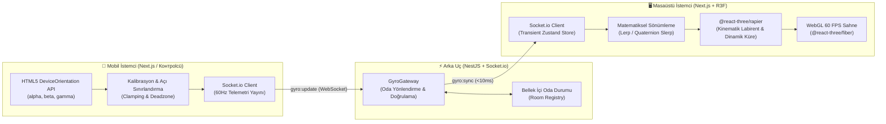
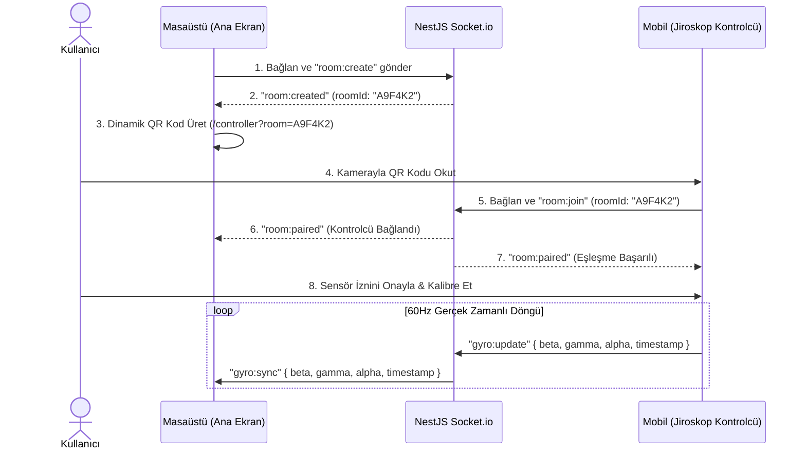

# 🏛️ GyroMaze Sistem ve Yazılım Mimarisi

Bu doküman, **GyroMaze** projesinin çapraz cihaz (Mobil → Sunucu → Masaüstü) gerçek zamanlı iletişim protokolünü, Socket.io oda yönetimini, QR kod tabanlı eşleşme akışını ve Three.js / Rapier 3B fizik-render hattını detaylandırır.

---

## 1. Yüksek Seviyeli Sistem Mimarisi

GyroMaze, **istemci-sunucu-istemci** (Mobil Kontrolcü → NestJS WebSocket Gateway → Masaüstü 3B Sahne) topolojisi üzerinde çalışır. Mimari, ağ gecikmesini **10 milisaniyenin altında** tutmak ve masaüstü ekranında **sabit 60 FPS** fizik simülasyonu sunmak üzere tasarlanmıştır.



---

## 2. Socket.io Oda (Room) Mantığı ve İletişim Protokolü

Her masaüstü oyun oturumu, NestJS üzerinde çalışan `GyroGateway` tarafından yönetilen izole bir **Socket.io Odası (Room)** oluşturur.

### 2.1. Oda Yaşam Döngüsü (Room Lifecycle)

1. **Oda Oluşturma (`room:create`):**
   - Masaüstü istemcisi uygulamayı açtığında sunucuya bağlanır ve `room:create` olayı gönderir.
   - Sunucu, çakışmasız 6 karakterli alfanümerik bir oda kodu (örn. `GM-84K9` veya `84K9X2`) üretir.
   - Masaüstü soketi bu odaya **Host (Ana Ekran)** rolüyle kaydedilir.
2. **Odaya Katılım (`room:join`):**
   - Mobil cihaz QR kodu okuttuğunda `/controller?room=84K9X2` rotasına yönlenir ve sunucuya `room:join` olayı gönderir.
   - Sunucu odanın varlığını ve odada başka aktif bir kontrolcü olup olmadığını doğrular.
   - Doğrulama başarılıysa mobil soket odaya **Controller (Kontrolcü)** rolüyle eklenir ve her iki cihaza `room:paired` olayı yayınlanır.
3. **Gerçek Zamanlı Veri Akışı (`gyro:update` → `gyro:sync`):**
   - Mobil istemci, sensörden okunan eğim verilerini (`beta`, `gamma`, `alpha` ve zaman damgası) `gyro:update` olayı ile sunucuya iletir.
   - Sunucu herhangi bir veritabanı yazımı yapmadan (zero-persistence) paketi doğrudan ilgili odadaki masaüstü istemcisine `gyro:sync` olayıyla aktarır.
4. **Bağlantı Kopması ve Kurtarma (`disconnect`):**
   - Mobil cihazın bağlantısı düşerse masaüstü ekranında oyun otomatik olarak duraklatılır (`game:paused`) ve yeniden bağlanma QR ekranı yumuşak bir geçişle (Framer Motion) gösterilir.

---

## 3. QR Kod ile Mobil-Masaüstü Eşleşme Akışı

Kullanıcının manuel kod yazma zahmetini ortadan kaldırmak için sıfır sürtünmeli bir eşleşme akışı uygulanır:



### Donanım İzinleri ve Kalibrasyon
- **iOS 13+ İzin Zorunluluğu:** Safari/WebKit tabanlı mobil tarayıcılarda `DeviceOrientationEvent.requestPermission()` yalnızca doğrudan bir kullanıcı etkileşimi (buton dokunuşu) içinde çağrılabilir. Mobil arayüzde eşleşme sonrası kullanıcıya şık bir **"Sensörleri Etkinleştir ve Başla"** butonu sunulur.
- **Sıfır Noktası Kalibrasyonu (Tare / Offset):** Kullanıcı telefonu elinde doğal tutuş açısıyla (örn. 30° eğimli) tutarken **"Kalibre Et"** butonuna bastığında mevcut `(beta0, gamma0)` değerleri referans kabul edilir ve sonraki tüm açılar bu referans noktasına göre (`Δbeta`, `Δgamma`) hesaplanır.

---

## 4. Three.js ve Rapier 3B Render & Fizik Hattı

Masaüstü istemcisi, görsel akıcılık ve gerçekçi fizik etkileşimi için **React Three Fiber (`@react-three/fiber`)** ve **Rapier (`@react-three/rapier`)** motorlarını birlikte kullanır.

### 4.1. Transient Durum Yönetimi (Sıfır React Re-render)
Saniyede 60 kez gelen WebSocket paketlerini React `useState` ile tutmak, bileşen ağacının sürekli yeniden oluşturulmasına (re-render) ve kare düşüşlerine (frame drop) yol açar. Bunun yerine:
- Gelen `GyroData` verisi Zustand deposunda veya doğrudan bir `MutableRefObject` içinde güncellenir.
- 3B sahne bileşenleri bu veriyi React render döngüsünü tetiklemeden doğrudan `useFrame((state, delta) => ...)` içinde okur.

### 4.2. Matematiksel Sönümleme (`Lerp` / `Slerp`)
Mobil sensörlerden gelen ham veriler mikro titreşimler (sensör gürültüsü) ve ağ paket aralıklarındaki ufak dalgalanmalar içerir. Labirentin keskin sıçramalar yapmasını önlemek için:

1. **Açı Sınırlandırma (Clamping):**
   Labirentin aşırı dönerek topun sahneden fırlamasını engellemek için hedef eğim açıları maksimum $\pm 25^\circ$ ($\approx 0.436\text{ rad}$) ile sınırlandırılır.
2. **Quaternion / Euler Enterpolasyonu:**
   Her karede (`useFrame`), mevcut labirent rotasyonu hedef rotasyona doğru kare hızından bağımsız (`delta` tabanlı) olarak yumuşatılır:
   ```ts
   // Hedef açılara doğru kare-bağımsız yumuşak geçiş
   currentRotation.x = THREE.MathUtils.damp(currentRotation.x, targetPitch, smoothingFactor, delta);
   currentRotation.z = THREE.MathUtils.damp(currentRotation.z, targetRoll, smoothingFactor, delta);
   ```

### 4.3. Sıfır Zıplamalı (Zero-Bounce) Tahta-Yerel Fizik ve Görsel Eğim Ayrımı
Kinematik bir zemini hızla döndürmek, fizik motorunda bilyeye yukarı yönlü (`+Y`) istenmeyen bir darbe uygulayarak bilyenin zıplamasına yol açar. GyroMaze bunu **Tahta-Yerel Sabit Fizik + Görsel Eğim Grubu** mimarisiyle çözer:
- **Sabit Çarpıştırıcılar (`RigidBody type="fixed"`):** Duvarlar, tuzak delikleri ve hedef portalı tahta-yerel uzayda sabit çarpıştırıcılar olarak çalışır.
- **Y Ekseni Kilitli Dinamik Küre (`enabledTranslations={[true, false, true]}`):** Fizik küresinin `Y` ekseni kilitlidir ve `ccd={true}` (Continuous Collision Detection) açıktır; eğim açıları $\theta_{\text{pitch}}, \theta_{\text{roll}}$ doğrudan yatay yerçekimi ivmesi bileşenlerine ($a_x = -g \sin\theta_{\text{roll}}$, $a_z = g \sin\theta_{\text{pitch}}$) dönüştürülür.
- **Görsel 3B Eğim Grubu (`visualTiltGroupRef`):** Tüm tahta, duvarlar, kristaller, lazerler ve görsel metal bilye tek bir `THREE.Group` içinde yer alır ve her karede `Quaternion.slerp` (katsayı `32`) ile sıfır gecikmeli olarak eğilir.

### 4.4. Sonsuz Prosedürel Bölüm Motoru (`generateProceduralLevel`)
- İlk 5 bölüm el yapımı olarak tanımlanmıştır (`Bölüm 01–05`).
- `Bölüm 06` ve üzerindeki tüm seviyeler (`06..∞`), seviye numarasını deterministik tohum (*Mulberry32 PRNG*) olarak kullanan 4×4 makro-hücreli **Spanning-Tree (DFS + Braided Loops)** algoritmasıyla üretilir.
- Her makro hücre $3.0\text{ birim}$ genişliğindedir ve hücreler arası duvarlar $2.4\text{ birim}$ uzunluğunda, $0.36\text{ birim}$ kalınlığındadır; böylece tüm koridorlarda en az **$2.64\text{ birim}$** güvenli geçiş açıklığı ve %100 çözülebilirlik garanti edilir.

